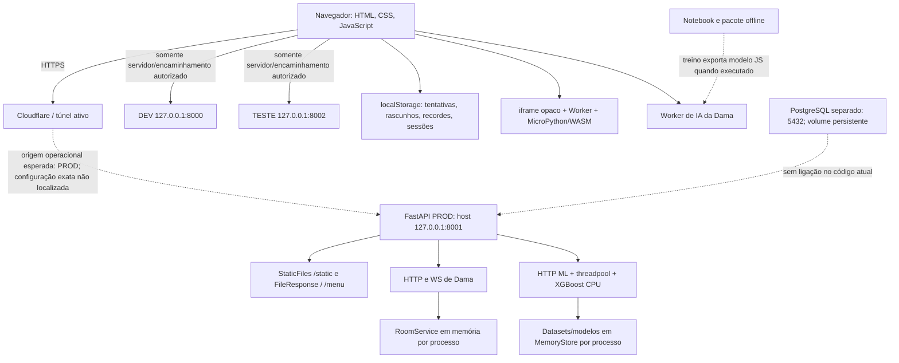

# Arquitetura, persistência e contratos

Data de consolidação: **15/10/2026**. Coleta iniciada em 13/10/2026; nomes de diretórios conservam a data inicial. Revisão: `b0a2ef0c01458b1e17fe4b34acdf29ef1acecd73`. Branch ativa no início: `main`; alterações locais preexistentes não são tratadas como aprovação.

Metodologia: inspeção de fonte/Git, hashes SHA-256, Docker e PostgreSQL somente leitura, perfis de navegador isolados, entrada física via CDP/WebDriver e testes em cópias temporárias. **Nenhuma correção, commit, push, publicação ou reinício de container existente nesta etapa.** A auditoria anterior foi preservada. Evidências: [diretório privado](../../private/general-audit-20261013/).

## Arquitetura em execução

A seta do túnel para PROD não substitui inspeção do ingress: o domínio está acessível, tem hashes compatíveis com a release, e o serviço cloudflared está ativo; o arquivo de configuração exato não foi obtido. TESTE/PROD compartilham o mesmo artefato e diferem em APP_ENV/bind. DEV contém drift preexistente.

## Fronteiras e contratos

- Frontend é multipágina, sem build de bundle. Dependências são globais declaradas em ordem nos HTMLs. Motores puros estão separados em Chess, DamaRules, PairEngine, RachaCucaEngine, MathMazeGame e DataScience; a UI chama esses contratos e refaz o DOM. Renderizadores/foco variam entre jogos.
- `site-ui.js` constrói links e estado da navegação; o HTML continua como fallback. A composição da marca é repetida nos documentos. CSS específico e compartilhado se sobrepõe; a ordem da cascata tem efeito funcional, como na Queda.
- Dama tem estado autoritativo no backend, IDs de sala e token de sessão. WS autentica na primeira mensagem, verifica Origin e revisões. Local/IA usa motor JS; pacote de pesquisa usa motor NumPy. As três variantes curtas precisam de paridade por corpus, não fusão apressada.
- Python executa no cliente. Parent carrega recursos locais, cria iframe sandbox sem allow-same-origin e Worker; cada execução usa instância nova. O parent verifica event.source, limita saída/código e encerra em 3 s; preparação tem timeout de 30 s. Não há endpoint de execução Python no backend. A CSP está no srcdoc do executor, não como política geral do site.
- ML recebe CSV como corpo limitado em streaming e nome como query, nunca como caminho de arquivo. Schema recusa extras/não finitos; split precede ajuste dos preprocessadores. O treino é síncrono dentro de threadpool, com n_jobs=1 e callback de deadline cooperativo. O semáforo limita treinos por processo. Não é timeout de processo garantido para todas as etapas nativas.
- Stores guardam IDs aleatórios-capacidade e TTL; não têm conta, sincronização ou persistência entre workers. O release opera sobre IDs fornecidos. Não existe armazenamento de arquivos de usuários no disco implementado por esse fluxo.

## Persistência e banco

| Informação | Onde vive | Recuperação e limite |
|---|---|---|
| Salas, movimentos e conexões | RoomService RAM por processo | TTL e reconexão no mesmo processo; reiniciar perde sala |
| Datasets/modelos ML | Dois MemoryStore RAM | 12 entradas cada por padrão; TTL 1800 s; release explícito |
| Tentativas Queda/Relâmpago | localStorage por origem | Até 1.000; sem vínculo de conta; falsificável pelo próprio usuário |
| Rascunhos/Python/DS | localStorage, chave versionada compartilhada | Retomada no mesmo perfil; registro malformado pode bloquear Python |
| Curso Xadrez/práticas | Sessão da página/memória | Algumas progressões não sobrevivem à visita |
| Recordes e configurações | localStorage específico de cada jogo | Quota/segurança tratados em vários adaptadores |
| PostgreSQL | Volume separado | Sem tabelas/FKs de aplicação nos dois DBs inspecionados; backend sem driver/conexão |

Não há ORM, migração SQL efetiva, transação relacional da aplicação ou integridade referencial a validar. As consultas foram BEGIN READ ONLY/COMMIT e não leram conteúdo de linhas de alunos. Volume existente não comprova que progresso do aluno esteja persistido nele. archive_mode=off não exclui pg_dump externo; restauração não foi comprovada.

## Qualidade e riscos estruturais

Boas fronteiras: motores puros, UI separada, validação Pydantic, stores com TTL/lock, executor Python opaco, fornecedores locais com hashes, backend sem execução arbitrária do código do aluno. Limites relevantes: globais/ordem de scripts, templates e CSS repetidos, três motores de Dama, representações de progresso sem validação estrutural completa, estado volátil e artefato DEV fora da revisão esperada. A ausência de CI executável e de lock deixa essas diferenças dependerem de processos manuais.

Escalar workers horizontalmente sem revisar salas/stores pode fragmentar sessões e IDs. A primeira medida proposta é estabilizar e testar contratos; persistência/filas/novos serviços dependem de requisitos e aprovação. Não foi implementada refatoração ou arquitetura nova nesta etapa.
