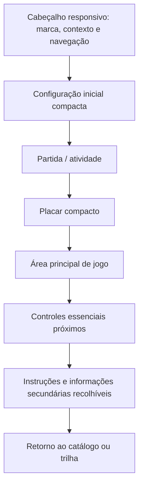

# Padrão de layout dos jogos e métricas

Data de consolidação: **15/10/2026**. Coleta iniciada em 13/10/2026; nomes de diretórios conservam a data inicial. Revisão: `b0a2ef0c01458b1e17fe4b34acdf29ef1acecd73`. Branch ativa no início: `main`; alterações locais preexistentes não são tratadas como aprovação.

Metodologia: inspeção de fonte/Git, hashes SHA-256, Docker e PostgreSQL somente leitura, perfis de navegador isolados, entrada física via CDP/WebDriver e testes em cópias temporárias. **Nenhuma correção, commit, push, publicação ou reinício de container existente nesta etapa.** A auditoria anterior foi preservada. Evidências: [diretório privado](../../private/general-audit-20261013/).

## Estrutura compartilhada proposta

A ordem acima é semântica; em largura suficiente, placar/controles/ajuda podem ir para uma lateral mantendo ordem de foco coerente. O header aberto pode crescer. A configuração fica compacta ou recolhida durante partida, mas continua acessível. O nome do jogo deve permanecer disponível; não duplicar títulos grandes apenas para preencher espaço.

## Orçamento de viewport

Usar largura disponível e altura visual efetiva, descontando a altura real do header e controles que precisem compartilhar a primeira tela. Em espaço insuficiente, permitir crescimento/rolagem de conteúdo ou mudar a distribuição para lateral. `min-height` e fluxo natural são distintos de `height` fixa: overflow não pode deixar elementos posteriores entrarem na arena/controles. `dvh/svh` são ferramentas, não garantias de encaixe; safe-area-inset e barras do navegador precisam validação real.

Não usar `body {overflow:hidden}` de forma geral. `touch-action:none` deve se restringir a superfícies que precisam controlar o gesto, como o Canvas do Labirinto. O restante da página e os painéis devem continuar roláveis. Manter foco e alvos, sem “resolver” espaço reduzindo controles essenciais.

## Métricas atuais de referência

Área visível é a interseção da caixa da área principal com a viewport em scroll inicial zero, dividida pela área total da viewport CSS. Inclui moldura/gaps da caixa, não pixels semanticamente ativos. Relâmpago usa caixa que une enunciado/input/confirmar; não é comparável a um tabuleiro quadrado. A rolagem da tabela é **mínimo geométrico estimado para mostrar o controle inteiro**, não a rolagem maior observada ao centralizá-lo pelo executor. Overlay pode tornar o alvo inacessível mesmo depois de rolar.

| Jogo | Viewport | Header px | Área principal px | Visível/viewport | Rolagem mínima estimada por controle |
|---|---|---|---|---|---|
| Dama | 375×667 | 76.6 | 355×355 | 50.4% | #restart-game: 85 px; #local-back: 155 px |
| Dama | 393×852 | 77.2 | 373×373 | 41.6% | #restart-game: 0 px; #local-back: 0 px |
| Dama | 1366×900 | 81.7 | 670×670 | 36.5% | #restart-game: 0 px; #local-back: 29 px |
| Xadrez | 375×667 | 76.6 | 355×355 | 50.4% | #chess-restart: 203 px |
| Xadrez | 393×852 | 77.2 | 373×373 | 41.6% | #chess-restart: 17 px |
| Xadrez | 1366×900 | 81.7 | 700×700 | 39.9% | #chess-restart: 0 px |
| Labirinto | 375×667 | 76.6 | 355×355 | 50.4% | #m-pause: 0 px; [data-direction="down"]: 0 px |
| Labirinto | 393×852 | 77.2 | 373×373 | 41.6% | #m-pause: 0 px; [data-direction="down"]: 0 px |
| Labirinto | 1366×900 | 81.7 | 450×450 | 16.5% | #m-pause: 0 px; [data-direction="down"]: 0 px |
| Queda | 375×667 | 76.6 | 355×336 | 47.6% | #q-pause: 0 px; #q-restart: 0 px |
| Queda | 393×852 | 77.2 | 373×521 | 58.0% | #q-pause: 0 px; #q-restart: 0 px |
| Queda | 1366×900 | 81.7 | 1014×405 | 33.4% | #q-pause: 0 px; #q-restart: 0 px |
| Pares | 375×667 | 76.6 | 355×380 | 53.9% | #pair-restart: 23 px |
| Pares | 393×852 | 77.2 | 373×380 | 42.3% | #pair-restart: 0 px |
| Pares | 1366×900 | 81.7 | 728×463 | 27.4% | #pair-restart: 0 px |
| Racha-Cuca | 375×667 | 76.6 | 355×355 | 50.4% | #rc-reset: 8 px; #rc-config: 78 px |
| Racha-Cuca | 393×852 | 77.2 | 373×373 | 41.6% | #rc-reset: 0 px; #rc-config: 0 px |
| Racha-Cuca | 1366×900 | 81.7 | 520×520 | 22.0% | #rc-reset: 0 px; #rc-config: 0 px |
| Relâmpago | 375×667 | 76.6 | 319×162 | 20.7% | #game-form button: 0 px |
| Relâmpago | 393×852 | 77.2 | 337×105 | 10.6% | #game-form button: 0 px |
| Relâmpago | 1366×900 | 81.7 | 708×123 | 7.1% | #game-form button: 0 px |

Os valores são diagnósticos do layout atual e de uma sessão de jogo; textos/estado podem mudar altura. Header dos jogos em 375×667 ocupa aproximadamente 11,5%. A ausência de controles na primeira tela pode ser aceitável em leitura longa, mas deve ser evitada para pausa/retomada/reinício frequentes. Não há meta universal de 70%, 80% ou outra porcentagem.

## Adaptações por jogo

| Tipo/jogo | Prioridade de layout | Adaptação proposta | Cuidado/teste |
|---|---|---|---|
| Xadrez/Dama | Board quadrado, peças/coordenadas, turno e ações de partida. | Amplo: board com painel lateral. Compacto: placar curto, board, controles antes de capturas/instruções recolhidas. | Manter orientação, promoção, casas-alvo, teclado, foco após render e leitura das coordenadas; regras intactas. |
| Labirinto | Mapa legível, números, placar e D-pad. | Amplo: controles/legenda laterais, orçamento de mapa sem subtrair altura da lateral. Compacto: mapa usa largura e D-pad próximo, com secundários recolhíveis. | Canvas lógico/bitmap/DPR e coordenadas de pointer; pausa/tutorial, swipe, som, resize durante partida e equivalente não visual. |
| Queda | Arena, expressão e pausa/retomada sem overlay externo. | Portrait: stack compacto em fluxo; landscape curto: arena e painel lateral/controles reorganizados conforme área. | Resolver contenção, não apenas z-index. Opções móveis continuam clicáveis; altura cresce se conteúdo não couber. |
| Pares | Duas colunas de representação/resposta e progresso. | Contexto/progresso compactos; cartões com representação proporcional à caixa; reinício junto da área. | Não trocar a relação entre colunas para “caber mais”; manter frações, rótulos, match, feedback e alvos. |
| Relâmpago | Pergunta, campo, confirmar e feedback. | Evitar título/placar dominar editor/resposta; manter botão alcançável com altura reduzida e foco no campo. | Teclado virtual real, inputmode, validação vazia, tentativa única, cronômetro e conclusão/replay. |
| Racha-Cuca | Puzzle proporcional, movimentos e feedback. | Jogo principal primeiro; tema/recorde/legenda secundários recolhíveis; controles estáveis abaixo/lateral. | Tabuleiro 3×3/4×4, textos longos, matemática/equações, keyboard, vitória e reset; não alterar embaralhamento. |

## Configuração, modais e retorno

Separar setup, loading, play, pause, error e result por estado explícito e acessível. Botão visível não é prova de que handler foi registrado. Botão desabilitado precisa motivo legível. Modais devem ser testados com viewport reduzida e foco/restauração. Retorno informa claramente se abandona/resetará sessão; a padronização visual não autoriza mudar regras de abandono/persistência.

Arquivos afetados por uma futura implementação: `css/game-layout.css`, `css/site.css`, estilos específicos e, onde necessário, funções de medição/foco dos jogos. IDs de controles, contratos de storage e rotas ficam estáveis. Nenhuma dessas mudanças foi aplicada.
